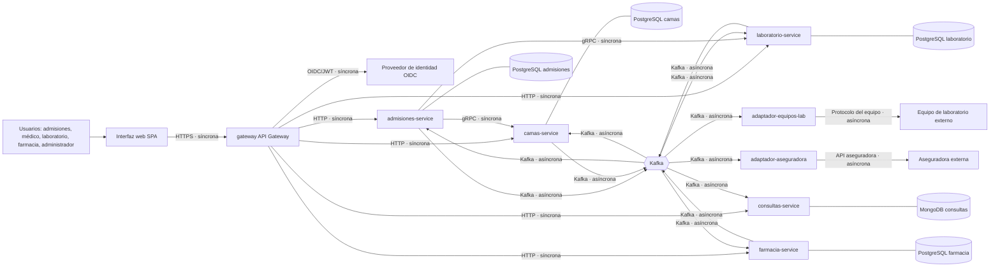

# Arquitectura de RedClínica (coordinación hospitalaria multisede)

> **Supuestos que debe validar el grupo** :
> nombre del proyecto "RedClínica", equipo de 4-5 personas, plazo de un semestre,
> despliegue con Docker Compose (sin Kubernetes), y pila PostgreSQL + MongoDB + Kafka + gRPC,
> la misma del ejemplo RICA. Si su pila real es distinta, cambie las tecnologías pero conserve la lógica.

---

## 1. Contexto y motivadores

**Qué hace.** RedClínica coordina admisiones, disponibilidad de camas, órdenes de laboratorio y
despacho de farmacia entre varias sedes de una red hospitalaria. Lo usan personal de admisiones,
médicos, laboratorio, farmacia y administradores. Se integra con sistemas externos (equipos de
laboratorio y aseguradoras) sin depender de ellos para operar. Es un sistema de operación clínica continua.

**Atributos de calidad prioritarios (ordenados):**

| # | Atributo | Escenario medible |
|---|---|---|
| 1 | **Disponibilidad** (operación clínica continua) | Con la aseguradora y el equipo de laboratorio apagados, registrar un ingreso y trasladar un paciente siguen funcionando con p95 < 1 s. La caída de `farmacia-service` no impide admitir ni trasladar. Meta: 99,9 % mensual en los servicios clínicos. |
| 2 | **Consistencia de ocupación de camas** | Con 50 solicitudes concurrentes sobre la misma cama, exactamente 1 tiene éxito (0 doble asignación). Un cambio de estado de cama se refleja en la consulta de ocupación en < 2 s (p95). |
| 3 | **Modificabilidad: aislamiento de integraciones** | Cambiar el protocolo de un equipo de laboratorio o de la aseguradora toca solo el adaptador; 0 líneas cambiadas en el dominio clínico (verificado por fitness function). |
| 4 | **Trazabilidad** | El 100 % de los traslados de un paciente se reconstruye en orden cronológico, con sede, servicio, cama, actor y hora; la consulta responde en < 1 s. |
| 5 | **Rendimiento de consulta** | Con 200 usuarios simultáneos, el estado consolidado del paciente (admisión, exámenes, medicación) responde en < 800 ms (p95). |

La **seguridad** (datos clínicos, autorización por sede) es transversal y no está en el top 5 como
atributo de diseño propio. Se trata en el gateway, en el proveedor de identidad y en la sección 7.

**Restricciones reales** ⚠️:
- Equipo pequeño (4-5 personas) y plazo de un semestre: pocos servicios, sin plataformas pesadas.
- Infraestructura: Docker Compose en máquinas del curso, sin Kubernetes.
- Tecnologías conocidas por el equipo: PostgreSQL, MongoDB, Kafka, gRPC, hexagonal.
- Los sistemas externos (aseguradora, equipos de laboratorio) se simulan con *mocks*.

### Trazabilidad de historias de usuario

| HU | Componente(s) que la resuelven |
|---|---|
| HU-01 Registrar ingreso | `admisiones-service` → `camas-service` (asigna cama) |
| HU-02 Disponibilidad de camas | `camas-service` (estado actual, fuente de verdad) |
| HU-03 Trasladar paciente | Saga orquestada en `admisiones-service` + `camas-service` |
| HU-04 Solicitar examen | `laboratorio-service` |
| HU-05 Registrar resultado (incl. equipo externo) | `laboratorio-service` + `adaptador-equipos-lab` |
| HU-06 Despachar medicamentos | `farmacia-service` |
| HU-07 Verificar cobertura | `admisiones-service` + `adaptador-aseguradora` |
| HU-08 Estado consolidado | `consultas-service` (CQRS lectura) |
| HU-09 Alta médica | `admisiones-service` → `laboratorio-service` (gRPC) |
| HU-10 Reporte de ocupación | `consultas-service` (modelo de ocupación) |

---

## 2. Estilos y patrones por componente

| Componente | Estilo / patrón | Almacén de datos | Comunicación | Atributo que sirve |
|---|---|---|---|---|
| `gateway` | API Gateway | — | HTTP entrante; valida JWT | Seguridad transversal; punto único de entrada para la interfaz |
| Proveedor de identidad (Keycloak) ⚠️ | Servicio de identidad externo (OIDC) | Propio | Emite JWT con rol y sedes autorizadas | Autorización por sede (HU-08) |
| `admisiones-service` | Microservicio + **hexagonal**; **saga orquestada** de traslados; Outbox | PostgreSQL | gRPC (llama a camas y laboratorio); eventos vía Outbox | Trazabilidad; aislamiento de integraciones (puerto de cobertura) |
| `camas-service` | Microservicio con fuente única de verdad, bloqueo optimista; Outbox | PostgreSQL | gRPC (sirve); eventos vía Outbox | Consistencia de ocupación |
| `laboratorio-service` | Microservicio + **hexagonal** (puerto `EquipoLaboratorio`); Outbox | PostgreSQL | REST desde gateway; gRPC (sirve conteo de pendientes); consume y publica en Kafka | Integridad (orden solo se cierra con resultado); modificabilidad |
| `farmacia-service` | Microservicio; Outbox | PostgreSQL | REST desde gateway; Kafka | Integridad (no despachar sin solicitud); disponibilidad aislada |
| `adaptador-equipos-lab` | **Anti-corruption layer** (adaptador), con *retry* y *circuit breaker* | — (sin estado) | Kafka ↔ protocolo del equipo | Modificabilidad; disponibilidad |
| `adaptador-aseguradora` | **Anti-corruption layer** (adaptador), con *retry* y *circuit breaker* | — (sin estado) | Kafka ↔ API de la aseguradora | Modificabilidad; disponibilidad |

### Prueba de necesidad (qué problema concreto resuelve cada estilo)

| Estilo | Problema concreto que resuelve aquí |
|---|---|
| Microservicios | Los dominios (camas, laboratorio, farmacia) tienen invariantes distintas, y la caída de uno (p. ej. farmacia) no debe frenar admisiones ni traslados. |
| Hexagonal | RNF: la lógica clínica no puede depender de la tecnología de cada integración; los puertos permiten cambiar adaptadores sin tocar el dominio. |
| Anti-corruption layer | Aísla los modelos y protocolos externos (formato del equipo, API de la aseguradora) del modelo clínico interno. |
| EDA + Outbox | Propaga hechos sin acoplar servicios y sin escritura dual: no se pierde un evento si Kafka cae. |
| Saga orquestada | El traslado abarca camas y admisiones; no hay transacción distribuida, y debe compensarse si falla a mitad. |
| CQRS (lectura) | HU-08 y HU-10 cruzan datos de 4 dominios; una vista materializada evita *joins* distribuidos y llamadas en cadena. |
| API Gateway | Un solo punto de autenticación y de entrada para la interfaz de cinco tipos de usuario. |
| Circuit breaker / retry | Los externos fallan, y sin esto un fallo del externo se propaga a la operación clínica. |

**Estilos considerados y descartados:**
- *Event sourcing completo*: la trazabilidad se logra con una tabla `traslado` solo de inserción y con el log de Kafka. Event sourcing añadiría costo (reconstrucción, versionado) sin un problema que lo exija. ⚠️ Revisar si el profesor lo quiere implementado como ejercicio.
- *CQRS en todos los servicios*: solo la consulta transversal lo justifica.
- *Service mesh y data mesh*: ver sección 6.
- *Monolito modular*: es una alternativa válida (ver ADR-001), pero la separación de camas y la aislación de fallos de integración piden fronteras de despliegue.

**Antipatrones evitados** ⚠️ (no tuve a la vista la sección 9 de la guía; contraste con su lista):
monolito distribuido (sin cadenas síncronas largas), base de datos compartida (cada servicio es dueño de la suya),
escritura dual (Outbox), dominio acoplado a SDKs externos (adaptadores), *over-engineering* (sin mesh ni event sourcing).

### Conexiones e integración

| Origen → Destino | Tipo | Razón |
|---|---|---|
| Interfaz web → `gateway` | HTTPS · síncrona | Interacción del usuario |
| `gateway` → servicios | HTTP/REST · síncrona | Consultar y ordenar; la respuesta se necesita ya |
| `admisiones` → `camas` | gRPC · síncrona | HU-01 y HU-03: el rechazo por falta de cama debe ser inmediato |
| `admisiones` → `laboratorio` | gRPC · síncrona | HU-09: el alta exige saber si hay órdenes pendientes ahora |
| Todos los servicios de dominio → Kafka | Kafka · asíncrona | Propagar hechos (vía Outbox) |
| Kafka → `consultas`, `laboratorio`, `farmacia`, `camas`, adaptadores | Kafka · asíncrona | Proyecciones, reacciones y trabajo con externos |
| `adaptador-*` ↔ sistemas externos | Protocolo externo · asíncrona respecto al flujo clínico | No bloquear la operación si el externo falla |

**Cadenas síncronas de más de dos saltos:** ninguna. Las más largas son `gateway → admisiones → camas` y
`gateway → admisiones → laboratorio` (2 saltos). El estado consolidado y la ocupación se sirven desde `consultas`
sin llamadas encadenadas.

**Verificación de cobertura (HU-07), sin bloquear:** `admisiones` registra la solicitud y publica
`VerificacionCoberturaSolicitada`. `adaptador-aseguradora` llama a la aseguradora con reintentos y publica
`CoberturaVerificada` o `CoberturaNoDisponible`. La admisión continúa con cobertura "pendiente de verificar"
y la interfaz muestra el estado. El dominio (`Cobertura`) vive en `admisiones`; el adaptador solo traduce.

**Resultados de equipos (HU-05):** el equipo envía el resultado al `adaptador-equipos-lab`, que lo traduce y
publica `ResultadoRecibidoDeEquipo`; `laboratorio-service` lo registra y cierra la orden. El personal también
puede registrar el resultado manualmente si el equipo no está disponible.

**Validación de la admisión en laboratorio y farmacia:** ambos servicios mantienen una proyección local de
admisiones activas (alimentada por `AdmisionRegistrada` y `AltaMedicaDada`), en vez de llamar a `admisiones` en cada solicitud.

### Eventos

| Evento (pasado) | Productor | Consumidores | Datos clave |
|---|---|---|---|
| `AdmisionRegistrada` | admisiones | laboratorio, farmacia, consultas | admisionId, pacienteId, sedeId, servicio, camaId, fecha |
| `TrasladoCompletado` | admisiones | camas (libera origen), consultas | trasladoId, admisionId, origen, destino, actor, fecha |
| `TrasladoFallido` | admisiones | consultas | trasladoId, motivo |
| `CamaOcupada` / `CamaReservada` / `CamaLiberada` | camas | consultas | camaId, sedeId, servicio, estado, fecha |
| `OrdenLaboratorioSolicitada` | laboratorio | adaptador-equipos-lab, consultas | ordenId, admisionId, tipoExamen |
| `ResultadoRegistrado` | laboratorio | consultas | ordenId, resultado, origen (manual/equipo) |
| `ResultadoRecibidoDeEquipo` | adaptador-equipos-lab | laboratorio | ordenId, resultado traducido |
| `SolicitudMedicamentoCreada` | farmacia | consultas | solicitudId, admisionId, medicamento, dosis |
| `MedicamentoDespachado` | farmacia | consultas | solicitudId, farmaceutico, fecha |
| `VerificacionCoberturaSolicitada` | admisiones | adaptador-aseguradora | admisionId, pacienteId |
| `CoberturaVerificada` / `CoberturaNoDisponible` | adaptador-aseguradora | admisiones, consultas | admisionId, cobertura / motivo |
| `AltaMedicaDada` | admisiones | camas, laboratorio, farmacia, consultas | admisionId, fecha |

Los consumidores deben ser **idempotentes** (Outbox implica entrega al menos una vez).

---

## 3. Diagrama de contenedores (C4, nivel 2)

---

## 4. Decisiones (ADR)

### ADR-001: Microservicios con adaptadores aislados para las integraciones externas

- Estado: Propuesta (pendiente de validación del grupo)
- Fecha: 2026-11-15

**Contexto.** El sistema debe seguir operando cuando fallan la aseguradora o los equipos de laboratorio, y la lógica
clínica no puede depender de la tecnología de cada integración. Los dominios de camas, laboratorio y farmacia tienen
invariantes distintas, y es una operación clínica continua.

**Decisión.** Separar el sistema en servicios por dominio y llevar cada integración externa a un servicio adaptador
propio (`adaptador-equipos-lab`, `adaptador-aseguradora`). Estos se comunican con el núcleo solo por eventos en Kafka, y
aplican reintentos y *circuit breaker* hacia el externo. El dominio define puertos (arquitectura hexagonal) y los adaptadores los implementan.

**Alternativas descartadas.**
- *Monolito modular con adaptadores como paquetes*: más simple de operar con un equipo pequeño, y habría sido válido. Se descartó porque un fallo o bloqueo de hilos en una integración externa degradaría el proceso completo y no se podría escalar ni desplegar por separado.
- *Llamada directa y síncrona del servicio clínico al externo*: acopla la disponibilidad clínica a la del externo, lo que viola el RNF 1.

**Consecuencias.**
- (+) La caída de un externo no bloquea admisiones, traslados ni altas.
- (+) Cambiar un protocolo externo toca un solo adaptador.
- (−) Más piezas que desplegar, observar y depurar (8 contenedores más Kafka y bases de datos).
- (−) Las operaciones con externos son de consistencia eventual: la interfaz debe mostrar estados "pendiente".
- (−) Riesgo de monolito distribuido si no se vigilan las cadenas síncronas.

### ADR-002: Traslado de pacientes como saga orquestada con reserva de cama

- Estado: Propuesta (pendiente de validación del grupo)
- Fecha: 2026-11-15

**Contexto.** HU-03 exige rechazar el traslado si no hay cama confirmada en el destino, y el RNF pide
consistencia de ocupación casi en tiempo real. El traslado afecta a `camas-service` (reserva y liberación) y a
`admisiones-service` (ubicación del paciente e historial). No hay una transacción distribuida entre ambas bases de datos.

**Decisión.** `admisiones-service` orquesta una saga con tres pasos:
1. Reservar la cama destino en `camas` (gRPC, idempotente por `trasladoId`, con expiración de la reserva).
2. Registrar el traslado en `admisiones` (tabla `traslado`, solo inserción) y publicar `TrasladoCompletado` por Outbox.
3. `camas` consume `TrasladoCompletado`, confirma la cama destino y libera la origen.

Si el paso 2 falla, se compensa con `CancelarReserva`. `camas-service` es la única fuente de verdad de la ocupación y usa bloqueo optimista.

**Alternativas descartadas.**
- *Coreografía pura*: sin orquestador, la lógica del traslado se reparte entre servicios y es difícil de seguir. Aquí el flujo es corto y el rechazo debe ser inmediato, así que un orquestador explícito es más claro.
- *Transacción distribuida (2PC)*: acopla ambas bases de datos y reduce la disponibilidad.
- *Admisiones y camas en un solo servicio*: elimina la saga, pero junta dos dominios con ritmos de cambio distintos.

**Consecuencias.**
- (+) Cero doble asignación de camas; el rechazo es inmediato y trazable.
- (+) El historial de traslados queda completo y ordenado.
- (−) Hay una ventana breve en la que la cama origen sigue ocupada tras el traslado.
- (−) Hay que gestionar reservas huérfanas (expiración) y fallos del orquestador a mitad de la saga (estado persistido y reintento).
- (−) La saga y las compensaciones son más difíciles de probar que una transacción local.

### ADR-003: CQRS de lectura para el estado consolidado y la ocupación (Propuesta )

- Estado: Propuesta (pendiente de validación del grupo)
- Fecha: 2026-11-15

**Contexto.** HU-08 (estado consolidado) y HU-10 (reporte de ocupación) cruzan datos de admisiones, laboratorio,
farmacia y camas, desde cualquier sede, con un objetivo de p95 < 800 ms. Consultarlos con llamadas síncronas encadenadas crearía dependencia de disponibilidad entre todos los servicios.

**Decisión.** `consultas-service` mantiene vistas materializadas en MongoDB, alimentadas solo desde los eventos de
Kafka: `paciente_consolidado` (por paciente), `ocupacion_por_sede` y un historial de eventos con marca de tiempo
para reconstruir la ocupación "en un momento dado". Es de solo lectura y filtra por las sedes autorizadas del usuario (claim del JWT).
La decisión operativa de HU-02 (¿hay cama?) se hace contra `camas-service`, no contra la vista.

**Alternativas descartadas.**
- *Consultas directas con composición en el gateway (API composition)*: acopla la disponibilidad de la consulta a la de cuatro servicios.
- *Réplica o base de datos compartida entre servicios*: rompe la propiedad de los datos por servicio.
- *Event sourcing para reconstruir el estado*: más costo del que justifica este problema.

**Consecuencias.**
- (+) Consulta rápida y disponible aunque un servicio de origen esté caído.
- (+) El reporte histórico y la trazabilidad se apoyan en el mismo historial de eventos.
- (−) Consistencia eventual: un médico puede ver datos con segundos de retraso; la interfaz debe mostrar "actualizado hace X s".
- (−) Duplicación de datos, y un consumidor que falla deja la vista desactualizada (se necesita idempotencia, reproceso y monitoreo del *lag*).

---

## 5. Fitness functions

1. **Dominio sin dependencias externas** (RNF 2, atributo 3).
   - *Regla:* las clases del paquete `dominio` no pueden importar `infraestructura`, `adaptador` ni SDKs de integración (cliente HTTP de la aseguradora, librerías del protocolo del equipo).
   - *Verificación:* prueba ArchUnit (o equivalente) en cada servicio con hexagonal.
   - *Cuándo:* en cada *pull request* (CI).
2. **Cada servicio es dueño de su base de datos.**
   - *Regla:* ningún servicio puede tener credenciales ni cadena de conexión hacia la base de otro servicio.
   - *Verificación:* script de CI que revisa `docker-compose.yml` y la configuración, y falla si una cadena de conexión apunta a una base ajena.
   - *Cuándo:* en cada *pull request*.
3. **Resiliencia ante caída de externos** (atributo 1).
   - *Regla:* con los *mocks* de aseguradora y equipo apagados, `POST /admisiones` y el traslado responden 2xx en < 1 s (p95), y la cobertura queda "pendiente".
   - *Verificación:* prueba de integración con Docker Compose que detiene los *mocks*.
   - *Cuándo:* en CI nocturno.
4. **No hay doble asignación de camas** (atributo 2).
   - *Regla:* con 50 solicitudes concurrentes sobre una misma cama, exactamente una tiene éxito.
   - *Verificación:* prueba de concurrencia contra `camas-service`.
   - *Cuándo:* en cada *pull request* que toque `camas` y en CI nocturno.
5. **Latencia de la consulta consolidada** (atributo 5).
   - *Regla:* p95 < 800 ms con 200 usuarios simultáneos.
   - *Verificación:* prueba de carga (k6 o JMeter) contra `consultas-service`.
   - *Cuándo:* antes de cada entrega.

---

## 6. Mesh: ¿lo necesitamos?

**Service mesh: no.** ⚠️ Son 7 servicios más el gateway, un solo equipo y despliegue en Docker Compose, sin Kubernetes.
Un mesh aporta mTLS, reintentos y observabilidad uniformes, pero con tan pocos servicios su costo operativo supera
el beneficio. Alternativa: *retry* y *circuit breaker* como librería en los adaptadores y en las llamadas gRPC, TLS en el
borde (gateway), y trazas con OpenTelemetry. Se reevaluaría con más de unos 15 servicios, requisitos uniformes de seguridad entre ellos y Kubernetes.

**Data mesh: no.** Hay un solo equipo y cinco dominios de datos dentro de una sola organización. Data mesh resuelve la
propiedad de datos entre muchos equipos de dominio y una plataforma analítica de datos como producto, lo cual no existe aquí.
Alternativa: cada servicio es dueño de su base, los contratos de eventos están documentados en este documento
(sección 2), y `consultas-service` cubre las necesidades de lectura y reporte.

---

## 7. Riesgos y deuda conocida

| Riesgo / deuda | Si se materializa |
|---|---|
| **Kafka como punto único de falla** (clúster central para todas las sedes). | Las lecturas quedan desactualizadas y los adaptadores se detienen, pero Outbox conserva los eventos y las operaciones clínicas síncronas siguen. Como mitigación futura: clúster replicado. |
| **`camas-service` como fuente única de verdad central**: si cae, no se pueden admitir ni trasladar pacientes. | Es la contrapartida de la consistencia (atributo 2 sobre 1 en este punto). Mitigación: réplicas del servicio y de la base de datos con *failover*; procedimiento manual de contingencia en papel. |
| **Condición de carrera entre el alta y una nueva orden de laboratorio** (HU-09). | Un alta podría pasar con una orden recién creada. Mitigación: marcar la admisión "alta en proceso" y rechazar órdenes nuevas en ese estado; probar el caso. |
| **Saga: fallo del orquestador a mitad o reservas huérfanas.** | Camas bloqueadas sin uso. Mitigación: estado de la saga persistido, reintento al reiniciar y expiración de reservas. |
| **Consistencia eventual en la vista consolidada.** | Un médico ve datos desactualizados. Mitigación: mostrar la hora de actualización y monitorear el *lag* del consumidor. |
| **Consumidores no idempotentes o evolución de eventos sin versionar.** | Duplicados o consumidores que se rompen al cambiar un evento. Mitigación: clave de idempotencia por evento y campo de versión en los contratos. |
| **Seguridad y privacidad de datos clínicos** (deuda). Autorización fina por sede, auditoría de accesos y cifrado de datos en reposo quedan en un nivel básico en el curso. | Acceso indebido a datos de pacientes. Mitigación: ampliar la verificación de `sedes` en el JWT a cada servicio y registrar accesos; revisar normativa aplicable en Colombia antes de cualquier uso real. |
| **Externos simulados con *mocks*** (deuda). | Los adaptadores pueden fallar con el comportamiento real de la aseguradora o del equipo. |

---

## Verificación de la lista del taller (autoevaluación; falta la revisión cruzada)

- [x] Los atributos de calidad están ordenados y tienen escenario medible
- [x] Cada fila de la tabla nombra el atributo que sirve
- [x] No hay un estilo sin problema concreto que lo justifique
- [x] El diagrama tiene flechas etiquetadas (tecnología y síncrona/asíncrona)
- [x] No hay cadenas síncronas largas sin comentario
- [x] Cada ADR tiene alternativa descartada y consecuencias negativas
- [x] La decisión sobre mesh está justificada con números
- [x] Hay al menos 2 fitness functions verificables
- [x] Hay riesgos y deuda reconocidos
- [ ] Una persona externa podría entender el documento en 10 minutos (**pendiente: revisión cruzada**)
